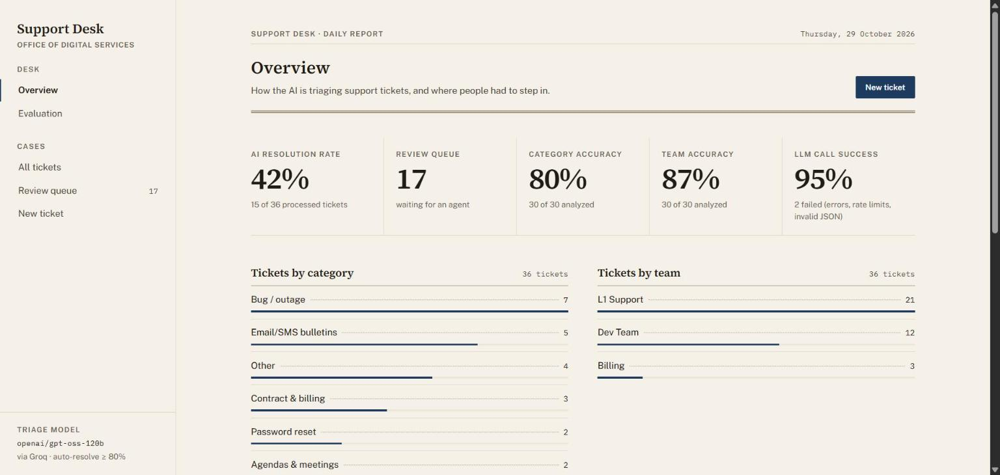
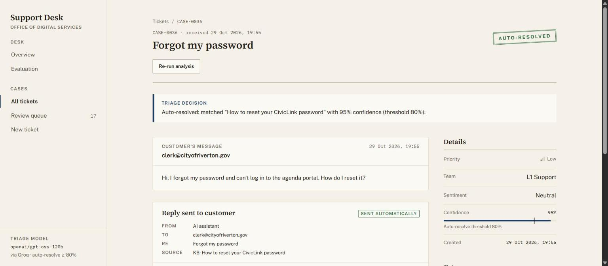
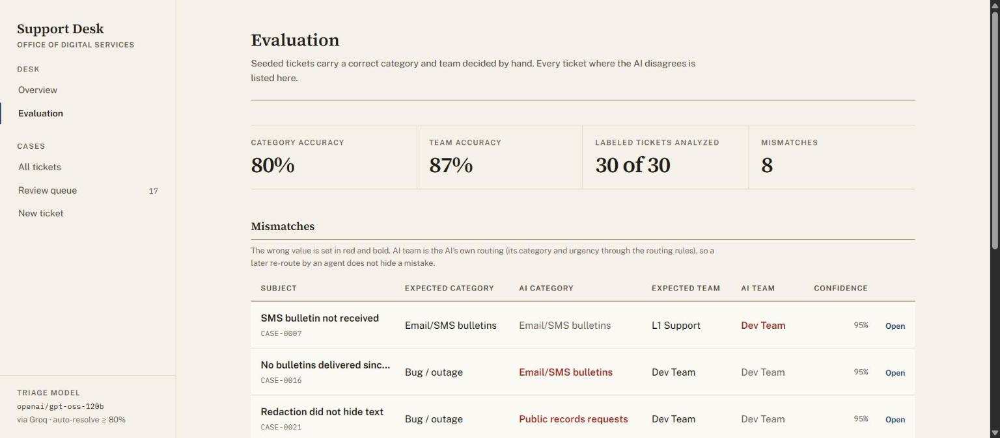
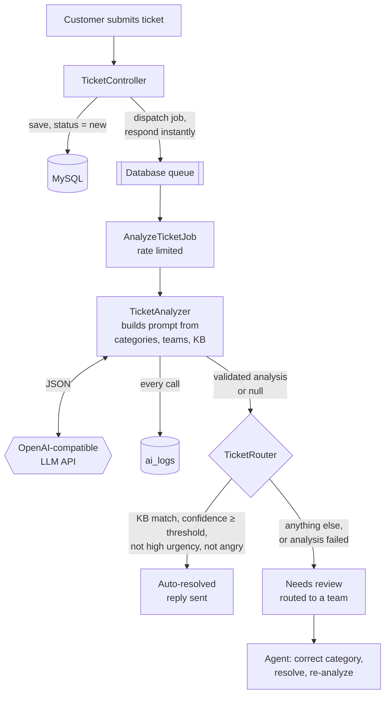

# AI Support Ticket Triage

[](https://youtu.be/5g6PxKeHLTA)

▶ 75-second demo: a ticket auto-resolved, an outage escalated, a vague ticket sent to human review.

A Laravel app that uses an LLM to triage support tickets automatically:

1. **Case enrichment**: every ticket gets a category, urgency (low/medium/high), a one-line summary and the customer's sentiment.
2. **Routing**: the ticket is assigned to a team (L1 Support, Dev Team, Billing) based on its category and urgency.
3. **Auto-resolution**: if a knowledge base article answers the ticket and the model is confident enough, the AI drafts a reply and resolves the ticket. Everything else goes to a human review queue, with the AI's draft attached as a suggested reply when it has one.

Humans stay in the loop. Reviewers can correct the AI's category, which re-routes the ticket. AI accuracy is measured against an **evaluation set**: every seeded ticket carries a hand-labeled correct category and team. Every LLM call is logged with its full prompt and raw response.

## Results

On the 30 hand-labeled GovTech tickets (model: openai/gpt-oss-120b via Groq):

- 43% auto-resolved (13 of 30 labeled tickets only)
- 80% category accuracy
- 87% team-routing accuracy

Every miss is listed on the Evaluation page and was used to refine the prompt rules.

## Screenshots

**Dashboard**: AI resolution rate, review queue and accuracy at a glance.



The live dashboard counts every ticket, including 6 submitted through the form for the demo (42%, 15 of 36); the Results above count only the 30 hand-labeled tickets.

**Ticket detail**: a password-reset ticket auto-resolved from a knowledge base article, with the reply that was sent.



**Evaluation**: accuracy against the hand-labeled tickets, with every mismatch listed.



**Stack:** Laravel 13 · PHP 8.4 · MySQL/MariaDB · Blade + Tailwind CSS 4 · database queue · any OpenAI-compatible LLM API (Groq, Gemini, OpenAI, local Ollama).

---

## Features

| Page | What it shows |
|---|---|
| **Dashboard** (`/`) | AI resolution rate, review queue size, category and team accuracy against the evaluation set ("X of Y analyzed"), LLM call success rate, tickets by category, tickets by team, most common human corrections |
| **Evaluation** (`/evaluation`) | Every hand-labeled ticket where the AI's category or team differs from the expected answer: expected vs. AI category, expected vs. AI team, confidence, and a link to the ticket |
| **Tickets** (`/tickets`) | All tickets with AI fields and status badges; filters for search, status, category, team and urgency; one-click review queue |
| **Ticket detail** (`/tickets/{id}`) | The customer message, the AI analysis, a one-sentence explanation of the decision, the drafted reply, a confidence bar with the threshold marked, the AI call log (prompt + raw response), and human actions: **correct category**, **mark resolved**, **re-analyze** |
| **Submit ticket** (`/tickets/create`) | Ticket form. It returns instantly; analysis runs on the queue and the detail page refreshes until it's done |

Two demo datasets are included, each with 10 knowledge base articles and 30 realistic tickets:

- **GovTech**: a SaaS platform for local government (meeting agendas, citizen email/SMS bulletins, website CMS, online forms, public records requests).
- **ERP**: a B2B ERP product (invoicing, inventory, reports, permissions, API).

Each dataset includes clear knowledge base matches, real problems that need a human, and deliberately tricky tickets: vague, angry, two issues in one, a possible security incident disguised as a password question, non-English, and a thank-you note.

---

## Architecture



### Responsibilities

| Class | Job |
|---|---|
| [`TicketAnalyzer`](app/Services/TicketAnalyzer.php) | Builds the prompt from the database, calls the LLM with Laravel's `Http` facade, extracts and validates the JSON, writes one `ai_logs` row per call. **Never throws**: it returns the validated analysis or `null`. |
| [`TicketRouter`](app/Services/TicketRouter.php) | Business rules in plain PHP: which team gets the ticket, and whether the AI may resolve it. Saves the outcome. |
| [`AnalyzeTicketJob`](app/Jobs/AnalyzeTicketJob.php) | Queueing concerns: rate limiting, retries, timeouts, and a `failed()` safety net that sends the ticket to review so it never stays stuck in `processing`. |
| [`TicketController`](app/Http/Controllers/TicketController.php) | Submit, list, detail and the human review actions. |
| [`DashboardController`](app/Http/Controllers/DashboardController.php) | Metric queries. |

### Ticket lifecycle

```
new ──► processing ──┬──► auto_resolved   (KB match + confidence ≥ threshold, not high urgency, not angry)
                     └──► needs_review ──► resolved (by a human)
```

Correcting the category of an `auto_resolved` ticket sends it back to `needs_review`, because the AI's answer was based on a wrong understanding.

### Data model

- **tickets**: customer input + AI fields (`category`, `urgency`, `summary`, `sentiment`, `assigned_team`, `kb_article_id`, `confidence`, `ai_reply`) + outcome (`status`, `resolved_by`) + `corrected_category`.
- **kb_articles**: `slug`, `title`, `content`.
- **ai_logs**: `ticket_id`, `prompt`, `raw_response`, `parsed_ok`, `error`.
- **categories** / **teams**: the domain's categories (with descriptions and a default team) and teams. They are **seeded per dataset, not hard-coded**, so the same code triages tickets for any product.

---

## Key design decisions

**The LLM provides the inputs; PHP makes the decisions.**
The model extracts structure from messy text (category, urgency, KB match, confidence). Routing and auto-resolution are deterministic PHP rules in `TicketRouter`. They're predictable, unit-tested, easy to audit ("why did this go to Dev Team?" is answered by one `if` statement), and they don't change when the provider updates a model.

**Prompt design** (see `systemPrompt()` in `TicketAnalyzer`)
- **System/user split:** the rules go in the system message, and the untrusted ticket text goes in the user message inside `<ticket>` tags, described as *data, not instructions*. A closing tag inside the customer's text is defused, so it can't break out of the block.
- **Domain from the database:** categories and teams are listed with their **descriptions**, and the full KB is included. The model can't classify reliably from bare slugs.
- **Every allowed value is defined.** For example, "high urgency = many users blocked, data loss, security incident, legal deadline", so answers stay consistent.
- **Explicit "kb_match must be null if…" rules** cover the cases that look answerable but aren't: bugs, possible security incidents, several issues in one ticket, vague tickets, refunds or contracts, legal questions. Auto-resolution is the only action that reaches a customer, so it gets the most guarding.
- **A confidence scale with anchors** (0.9+ = "clearly asks exactly what one article answers"), plus "a keyword is NOT enough".
- **Reply drafts are limited to the matched article:** no invented features, links or promises.
- **`temperature: 0`** so the same ticket gets the same classification.

**Valid JSON is enforced three ways.** An exact output template in the prompt, `response_format: json_object` (JSON mode), and a parser that still copes with code fences or extra text. The result is then validated with Laravel's `Validator`: required keys, allowed values loaded from the database, `confidence` between 0 and 1, and a reply required whenever there's a KB match. Harmless formatting slips (`"High"`, `"null"` as a string) are normalised first, so a correct answer isn't rejected over formatting.

**Failure is a normal outcome.** Network errors, HTTP errors, invalid JSON and invalid values all produce a logged `ai_logs` row and a ticket in `needs_review`. Retries only happen where a retry can help: connection errors, 429 and 5xx, with backoff that respects the provider's `Retry-After` header. A bad API key (401) or bad request (400) fails immediately.

**Staying under rate limits.** Laravel's `RateLimited` job middleware holds jobs back when they would exceed `LLM_REQUESTS_PER_MINUTE`. Held-back jobs are released back onto the queue, so the job uses `retryUntil()` instead of a fixed `$tries`: waiting your turn isn't a failure.

**AI output is tested, not trusted.** Each seeded ticket has `expected_category` and `expected_team`, decided by hand before the AI sees it (the labeling rules for ambiguous tickets are written in the seeders). The dashboard scores the AI against them and lists every miss. Team accuracy uses the AI's own routing (its category and urgency through the routing rules), so an agent re-routing a ticket can't hide an AI mistake. Tickets submitted through the form have no labels and are not scored.

**Human corrections are data too.** `category` keeps the AI's answer and `corrected_category` keeps the human's. On live tickets, which have no labels, the "most common corrections" table shows which category descriptions in the prompt need work.

**Every decision is explainable.** The detail page shows a one-sentence reason (`Ticket::decisionReason()`), the confidence against the threshold, whether routing escalated the ticket, and the exact prompt and response for each LLM call.

---

## Setup

### Requirements
- PHP **8.3+** with `pdo_mysql`, `mbstring`, `openssl`, `curl`
- Composer 2
- MySQL 8 or MariaDB 10.4+
- Node.js **20.19+** (22 or 24 LTS recommended) for the Vite build
- An API key for an OpenAI-compatible LLM provider (Groq's free tier works), or a local Ollama install

### Install

```bash
git clone https://github.com/gaurangsisodiya/ai-ticket-triage.git ai-ticket-triage
cd ai-ticket-triage

composer install
npm install
npm run build

cp .env.example .env        # Windows PowerShell: copy .env.example .env
php artisan key:generate
```

Create a database and fill in the `DB_*` settings in `.env`:

```sql
CREATE DATABASE ai_ticket_triage CHARACTER SET utf8mb4 COLLATE utf8mb4_unicode_ci;
```

Add your LLM key to `.env`:

```env
LLM_API_KEY=gsk_...
```

Create the tables and load a demo dataset:

```bash
php artisan migrate --seed                       # GovTech dataset (default)
# or: php artisan db:seed --class=ErpDemoSeeder  # switch to the ERP dataset at any time
```

### Run

Use three terminals:

```bash
php artisan serve                                # http://localhost:8000
php artisan queue:work --queue=default,backfill  # processes AI analysis jobs
npm run dev                                      # optional: rebuilds CSS while you edit views
```

Seeded tickets are inserted unanalyzed. Queue them all with:

```bash
php artisan tickets:queue-pending
```

At the Groq free tier's pace (2 tickets per minute), 30 tickets take about 15 minutes. Watch the dashboard fill up.

**Why two queues:** live submissions go on `default` and bulk jobs from `tickets:queue-pending` go on `backfill`. The worker always empties `default` first, so a customer who submits a ticket during a 15-minute backfill gets it analyzed within seconds instead of waiting behind the batch. A plain `queue:work` only listens to `default`, so pass `--queue=default,backfill`.

**After changing PHP code**, restart the worker (`php artisan queue:restart`), because a running worker keeps the code it started with.

### Useful commands

| Command | What it does |
|---|---|
| `php artisan tickets:analyze {id}` | Runs the analyzer on one ticket and prints the JSON. It doesn't change the ticket; handy for prompt experiments. |
| `php artisan tickets:queue-pending` | Queues analysis for every ticket with status `new`, on the low-priority `backfill` queue |
| `php artisan db:seed --class=GovTechDemoSeeder` | Wipes the demo data and loads the GovTech dataset (or `ErpDemoSeeder`) |
| `php artisan test` | Runs the test suite (no API key or network needed) |

### Windows notes
- If `php` on your PATH is an older version (e.g. XAMPP's 7.4), call PHP 8.4 by its full path: `C:\php84\php.exe artisan ...`.
- **cURL error 60 (SSL certificate)** means PHP has no CA bundle. Download https://curl.se/ca/cacert.pem and set `curl.cainfo` and `openssl.cafile` in `php.ini` to its path.
- If PowerShell blocks `npm` ("running scripts is disabled"), run `Set-ExecutionPolicy -Scope CurrentUser RemoteSigned`, or use `npm.cmd`.
- Job `$timeout` is only enforced where PHP has `pcntl` (Linux/macOS). On Windows, the HTTP timeout in the analyzer keeps jobs from hanging.

---

## Configuration

All settings live in `.env` and are read through [`config/ai.php`](config/ai.php). Application code never calls `env()` directly, so `php artisan config:cache` works.

| Variable | Default | Purpose |
|---|---|---|
| `LLM_PROVIDER` | `groq` | Label shown in the UI and logs |
| `LLM_BASE_URL` | `https://api.groq.com/openai/v1` | OpenAI-compatible base URL (`/chat/completions` is appended) |
| `LLM_API_KEY` | – | Sent as a Bearer token |
| `LLM_MODEL` | `openai/gpt-oss-120b` | Model name at the provider |
| `LLM_TIMEOUT` | `30` | Seconds per HTTP attempt |
| `LLM_JSON_MODE` | `true` | Send `response_format: json_object`. Set `false` for providers that reject it. |
| `LLM_REQUESTS_PER_MINUTE` | `2` | Queue throttle. `0` = unlimited (e.g. local Ollama). |
| `AI_AUTO_RESOLVE_THRESHOLD` | `0.8` | Minimum confidence for auto-resolution |
| `ROUTING_FIRST_LINE_TEAM` | `L1 Support` | Owner of uncategorized/failed tickets; the team that high-urgency tickets are escalated away from |
| `ROUTING_ESCALATION_TEAM` | `Dev Team` | Where high-urgency first-line tickets go |
| `DB_QUEUE_RETRY_AFTER` | `240` | Must be longer than the job's 180s timeout, or a slow job could run twice |

### Switching LLM provider

Change three lines in `.env`. No code changes are needed.

```env
# Groq (free tier: ~8,000 tokens/min ≈ 2 tickets/min)
LLM_BASE_URL=https://api.groq.com/openai/v1
LLM_MODEL=openai/gpt-oss-120b

# Google Gemini (OpenAI-compatible endpoint)
LLM_BASE_URL=https://generativelanguage.googleapis.com/v1beta/openai
LLM_MODEL=gemini-2.0-flash

# Local Ollama (any non-empty API key)
LLM_BASE_URL=http://localhost:11434/v1
LLM_MODEL=llama3.1
LLM_API_KEY=ollama
LLM_REQUESTS_PER_MINUTE=0
```

Model names change over time: providers retire models (this project lived through one). If you get a 404 `model_not_found`, list the provider's current models and update `LLM_MODEL`.

---

## Tests

```bash
php artisan test
```

48 feature tests on an in-memory SQLite database. The LLM is faked with `Http::fake()`, so no key or network is needed.

| Test file | Covers |
|---|---|
| `TicketAnalyzerTest` | Request format, valid response, JSON inside code fences, invalid values, missing keys, non-JSON, 5xx retried, 401 not retried, `Retry-After` honoured, connection failure never throws |
| `TicketRouterTest` | Default team, escalation, specialists not escalated, threshold boundaries (0.80 vs 0.79), suggested reply kept on review, failed analysis |
| `AnalyzeTicketJobTest` | Analysis saved and routed, failure → review, `failed()` never leaves a ticket in `processing` |
| `TicketSubmissionTest` | Form, validation, job dispatched, and no AI work during the request |
| `TicketPagesTest` | List filters (including the corrected category), detail page, correction re-routes and reopens, resolve, re-analyze |
| `DashboardTest` | Every metric against a known dataset; evaluation scoring (escalation, agent re-routes, unlabeled tickets, tickets waiting for re-analysis) and the Evaluation page; empty dashboard (no division by zero) |

---

## Project structure

```
app/
  Console/Commands/      tickets:analyze, tickets:queue-pending
  Http/Controllers/      TicketController, DashboardController, EvaluationController
  Http/Requests/         StoreTicketRequest
  Jobs/                  AnalyzeTicketJob
  Models/                Ticket, KbArticle, AiLog, Category, Team
  Services/              TicketAnalyzer (LLM), TicketRouter (rules), Evaluation (scores the AI against the labels)
config/ai.php            all AI/routing settings
database/seeders/        DemoSeeder (base), GovTechDemoSeeder, ErpDemoSeeder
resources/views/         dashboard, evaluation, tickets/{index,show,create}, components/{layout,badge,bar-list}
tests/Feature/           see the table above
```

---

## Known limitations

- **No authentication.** Anyone can correct or resolve tickets, and corrections aren't attributed to a person.
- **The evaluation set is small.** 30 labeled tickets per dataset, labeled by one person; a few labels are judgement calls. It catches regressions and patterns, not small differences in accuracy.
- **LLM confidence is self-reported.** It's a useful signal, but it isn't calibrated against real outcomes.
- **The whole knowledge base is sent with every request.** That's about 2,500 prompt tokens with 10 articles; it doesn't scale to hundreds of articles.
- **Replies aren't actually emailed.** "Sent to customer" means the reply is stored as the resolution.
- **Prompt-injection defences reduce risk but aren't bulletproof.** The real safeguard is that nothing reaches a customer without passing PHP validation and the confidence threshold.

## Future improvements

**Better AI decisions**
- **Retrieval (RAG) for large knowledge bases:** embed the articles, retrieve the 3–5 most relevant per ticket, and send only those. This cuts tokens and cost and scales to thousands of articles.
- **Strict structured outputs** (`response_format: json_schema`) on providers that support it, so the schema is enforced by the API rather than only validated afterwards.
- **A bigger evaluation set and a CLI runner:** label more tickets (including expected auto-resolve vs. review), and add an artisan command that runs the set against a prompt or model change and fails if accuracy drops, so every change is measured before deploying.
- **Confidence calibration:** use correction history to measure how often 0.9 really means right, then tune the threshold or set per-category thresholds.
- **A feedback loop:** feed frequent corrections back into category descriptions or few-shot examples in the prompt.
- **Per-category auto-resolve policy:** high-urgency tickets and angry customers are never auto-resolved today. Some categories (e.g. billing) could be excluded the same way, configured per category instead of hard-coded.
- **Prompt versioning:** store a prompt version on each `ai_logs` row to compare versions on real traffic.

**Human workflow**
- **Authentication and roles,** with an audit trail of who corrected or resolved what.
- **Reviewer-editable replies** with "approve & send", and real email delivery through Laravel Mail.
- **Live updates** (Laravel Reverb / websockets) instead of page refresh.

**Operations**
- **Redis queue + Laravel Horizon,** with Supervisor on Linux to keep workers running.
- **Token usage and cost tracking** from the `usage` field the API already returns (stored in `ai_logs.raw_response`).
- **PII redaction** before ticket text is sent to a third-party LLM.
- **Ticket ingestion** from email (IMAP) or helpdesk tools (Zendesk, Freshdesk) via webhooks.
- **Fallback provider:** switch to a second LLM provider automatically when the primary is down or rate-limited.

## Author

Gaurang Sisodiya · [GitHub](https://github.com/gaurangsisodiya) · [Trailhead](https://www.salesforce.com/trailblazer/gaurang-sisodiya)
